<h3><code>hurveen@github ~ $ ./contributions.sh</code></h3>

  

<h3><code>hurveen@github ~ $ whoami</code></h3>
<table>
<tr>
<td valign="top"></td>
<td valign="top"></td>
</tr>
</table>

  

<h3><code>hurveen@github ~ $ cat stack.txt</code></h3>

  

<h3><code>hurveen@github ~ $ ./links.sh</code></h3>

<b>CS student · Aspiring full-stack engineer</b>

